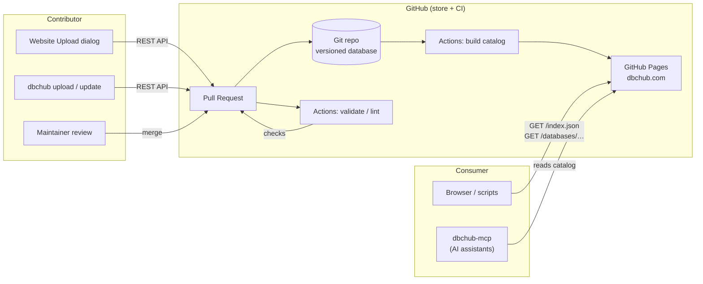

# dbchub

A **Git-native repository for signal databases**: DBC, ARXML, LDF, DBF, KCD, SYM.
The Git repo *is* the database: every file is versioned, every change is reviewed,
and the whole thing runs on GitHub with no server to host.

## Architecture at a glance



- **Storage**: files live under `databases/<manufacturer>/<model>/<bus>/<name>.<ext>`. Git gives
  history, diff, rollback and permalinks for free.
- **Read API**: a static catalog (`index.json` + per-file metadata) served by GitHub
  Pages / CDN. No backend.
- **Write API**: `upload`/`update` open a **Pull Request** via GitHub's REST API.
- **Check**: GitHub Actions parses and lints every changed file; invalid files block
  the merge.

## The API

### Read (static, served from https://dbchub.com)

| Request | Returns |
|---|---|
| `GET /index.json` | the full catalog |
| `GET /databases/{manufacturer}/{model}/{bus}/{name}.json` | one database's metadata |
| `GET /databases/{manufacturer}/{model}/{bus}/{name}.structure.json` | its nodes, messages and signals (ID, length, senders, cycle time; start bit, length, byte order, scaling, range, unit, receivers, multiplexing, value tables) |
| `GET /databases/{manufacturer}/{model}/{bus}/{name}.{ext}` | the raw file (latest) |
| `GET /raw/{commit-sha}/databases/.../{name}.{ext}` | a pinned historical version (via `raw.githubusercontent.com`) |

Example metadata record:

```json
{
  "name": "engine", "format": "dbc",
  "manufacturer": "toyota", "model": "prius-2010", "bus": "can",
  "license": "MIT", "source": "comma.ai opendbc",
  "checksum": "sha256:…", "counts": { "nodes": 6, "messages": 26, "signals": 78 },
  "valid": true, "commit": "a1b9f3c", "updated": "2026-11-10",
  "download": "https://dbchub.com/databases/toyota/prius-2010/can/toyota_prius_2010_pt.dbc"
}
```

### Write: two ways, both end in a Pull Request

**A. From the website (Docker Hub-style UI).** The Explore page has **Upload** and
**Download** built in. Download is a direct link to the file on Pages. Upload opens a
dialog where the visitor supplies their own GitHub token and fork; the browser then
calls the GitHub REST API directly (create branch → commit → open PR), with **no backend
and nothing stored server-side**. The token is used only against `api.github.com` and is
never sent anywhere else. Set the PR target in `site/_config.yml`:

```yaml
upstream_repo: "org/dbchub"   # where frontend uploads open their PR
```

**B. From the CLI** (same three API calls, scripted):

```bash
export GITHUB_TOKEN=github_pat_... # fine-grained: your fork only, Contents + Pull requests: write

uv run dbchub upload engine.dbc \
    --repo you/dbchub --upstream org/dbchub \
    --manufacturer toyota --model prius-2010 --bus can

uv run dbchub update databases/toyota/prius-2010/can/toyota_prius_2010_pt.dbc \
    --repo you/dbchub --upstream org/dbchub
```

Either way a branch is created, the file committed, and a PR opened. Use a fine-grained
token limited to your fork (Contents and Pull requests: read and write). If GitHub won't
let that token open the PR on the upstream repo, the file is still committed to your fork
and you get a prefilled GitHub "compare" link to open the PR with one click. Prefer plain git?
`fork → branch → PR` does exactly the same thing.

> **Nicer "Sign in with GitHub" button?** The token-paste flow stays 100% static. If you
> want a one-click OAuth login instead, add a single serverless function (Cloudflare
> Workers / Vercel) to do the OAuth code exchange, the only server-side piece in the
> whole project. The browser upload logic in `site/assets/js/app.js` is unchanged.

### MCP server (for AI assistants)

`dbchub-mcp` exposes the same read API as a read-only [Model Context
Protocol](https://modelcontextprotocol.io) server over Streamable HTTP, so assistants
(Claude, IDE agents, …) can browse the catalog, look up frames and signals, and fetch
files. Its data source is either the local build output or the **published site URL**,
so it can run anywhere without a checkout or the parsers:

```bash
uv run dbchub-build && uv run dbchub-mcp          # local: http://127.0.0.1:8765/mcp

# remote, reading from https://dbchub.com, behind a token
DBCHUB_MCP_TOKEN=… uv run dbchub-mcp --source https://dbchub.com/ \
    --host 0.0.0.0 --allowed-host mcp.example.com
```

| Tool | Does |
|---|---|
| `list_databases` / `list_manufacturers` | browse and filter the catalog |
| `get_database` | metadata, license/attribution, validation, export formats |
| `list_messages` / `get_message` | frames and full signal definitions (by name or ID) |
| `search_signals` | find a signal or message (name or ID) across every database |
| `get_database_file` | the raw file or a converted export (chunked for large files) |
| `get_history` | committed versions and what each changed |

Connect a client, e.g. Claude Code:
`claude mcp add --transport http dbchub https://mcp.example.com/mcp --header "Authorization: Bearer …"`.
Other options: `--transport stdio` (local subprocess), `--port`/`PORT`, `--path`,
`--allowed-origin`, `--cache-ttl`. `GET /healthz` is unauthenticated for probes. Writes
stay PR-only; terminate TLS at a reverse proxy when exposing it publicly.

### Check (automatic)

On every PR, `.github/workflows/validate.yml` runs `scripts/validate.py`:
parse validity, duplicate frame IDs, duplicate/unitless signals, bit-overflow, and a
cantools second-opinion parse for DBC/ARXML/KCD/SYM. Results appear in the PR checks.
`.github/workflows/test.yml` runs the code's test suite (`tests/`) on every PR too.

## Repository layout

Databases are organised **by car manufacturer**:

```
databases/<manufacturer>/<model>/<bus>/<name>.<ext>   # the databases themselves
pyproject.toml                           # uv project: dependencies + script entry points
uv.lock                                  # pinned, reproducible dependency set
scripts/validate.py                      # parse + lint + metadata (the "check")
scripts/build_index.py                   # generate catalog data for Jekyll (the "read API")
scripts/serve.py                         # build + serve the site locally
scripts/mcp_server.py                    # read-only MCP server over HTTP (dbchub-mcp)
cli/dbchub.py                            # write client (upload/update -> PR)
tests/                                   # pytest smoke tests (uv run pytest)
site/                                    # Jekyll site (source), Docker Hub-style UI
  _config.yml                            #   site config (incl. upstream_repo)
  _layouts/default.html                  #   nav bar + page shell
  index.html                            #   Explore page: facets, repo cards, modals
  assets/css/style.css                   #   styles
  assets/js/app.js                       #   filtering, detail view, browser upload -> PR
  404.html, robots.txt, sitemap.xml       #   not-found page and crawler files
  Gemfile                                #   github-pages gem, for local preview
.github/workflows/validate.yml           # validates databases on every PR
.github/workflows/test.yml               # runs the tests on every PR
.github/workflows/sync-sources.yml       # weekly re-import of third-party sources (PR)
.github/dependabot.yml                   # keeps pinned actions and uv.lock up to date
.github/workflows/publish.yml            # generates data + builds Jekyll + deploys on merge
```

The catalog data (`site/_data/catalog.json`, `site/index.json`), the slim browse list
(`site/browse.json`), the signal search index (`site/search-index.json`), the home-page activity feed (`site/_data/recent.json`) and the
downloadable file copies (`site/databases/`) are **generated** by `build_index.py` and
are gitignored. "Added" / "updated" dates come from the first / last commit touching
each file, so the publish workflow needs full git history (`fetch-depth: 0`).

## Local development

Dependencies are managed with [uv](https://docs.astral.sh/uv/). `uv run` creates and
syncs the project virtualenv automatically, so no manual install step is needed.

```bash
# build the catalog and serve the site at http://127.0.0.1:4000
uv run dbchub-serve

# validate everything  (entry point defined in pyproject.toml)
uv run dbchub-validate --root databases

# run the tests
uv run pytest
```

`dbchub-serve` regenerates the catalog data and then runs Jekyll's dev server (which
live-reloads edits to the site). It needs Ruby + Bundler for Jekyll; the first run does
`bundle install` automatically. Options: `--host`, `--port`, and `--no-build` (serve
without regenerating). Editing files under `databases/` requires a rebuild, so re-run
the command (or `uv run dbchub-build`).

The scripts are linked to the project as entry points: `dbchub-serve`, `dbchub-validate`,
`dbchub-build`, and `dbchub` (the write client). You can also run the files directly with
`uv run scripts/serve.py …`. Use `uv sync` to materialise `.venv` ahead of time and
`uv lock` to refresh the lockfile.

## Legal

Automotive signal databases are frequently proprietary, so the project is built around
**only accepting files the contributor has the right to share**, reviewed before merge.

| Document | Covers |
|---|---|
| [`LICENSE`](LICENSE) | Code license: **Apache-2.0** |
| [`LICENSE-DATA`](LICENSE-DATA) | Database content license: **CC BY 4.0** (originals) |
| [`ATTRIBUTIONS.md`](ATTRIBUTIONS.md) + [`databases/SOURCES.json`](databases/SOURCES.json) | Provenance & licenses of **imported** databases (kept under their own license) |
| [`CONTRIBUTING.md`](CONTRIBUTING.md) | How to contribute + **DCO** sign-off (`git commit -s`) |
| [`ACCEPTABLE_USE.md`](ACCEPTABLE_USE.md) | Prohibited / permitted content |
| [`TAKEDOWN.md`](TAKEDOWN.md) | Notice-and-takedown (DMCA) process |
| [`DISCLAIMER.md`](DISCLAIMER.md) | No warranty; **not for safety-critical use** |
| [`TERMS.md`](TERMS.md) / [`PRIVACY.md`](PRIVACY.md) | Terms of use; privacy (tokens stay client-side) |

These documents are not legal advice. If you run your own deployment, adapt them, set
your own contact address in `site/_config.yml` and the copyright holder in
[`NOTICE`](NOTICE), and have them reviewed. For US DMCA safe harbor, register a
designated agent with the Copyright Office.

The website also has a **Legal page** (`/legal/`, linked in the nav and footer) that
summarizes the licenses and lists each database source with its license and attribution,
generated from the catalog.

**Security.** The frontend is hardened against XSS (strict Content-Security-Policy, no
inline JS, untrusted catalog data rendered via `textContent` only, escaped templating)
and validates upload inputs before they reach the GitHub API. Vulnerability reporting and
the full list of protections are in [`SECURITY.md`](SECURITY.md).

## Setup checklist for a new deployment

1. Push this repo to GitHub.
2. **Settings → Pages → Source: GitHub Actions**, set the custom domain and tick
   **Enforce HTTPS**.
3. **Settings → Branches**: protect `master` (require a PR, one approval, and the
   *Validate databases* and *Tests* checks; block force-pushes).
4. Merge a PR (or push to `master`) to trigger the first catalog build.
5. Set `upstream_repo` and `contact_email` in `site/_config.yml`, and adapt the legal
   documents above.
6. Tell contributors to fork and use the website Upload button, the CLI, or raw PRs.

## Notes & extensions

- **Large ARXML**: enable **Git LFS** for `*.arxml` if files get big.
- **LDF**: canmatrix's LDF support depends on extras; if a format fails to parse,
  `validate.py` reports it rather than crashing.
- **Search**: the `/browse/` page fetches `browse.json` (a slim catalog without lint
  warnings, ~70 KB for ~120 files) and filters/pages it client-side; split it or move
  to a prebuilt search index if the catalog grows into the tens of thousands.
- **Direct writes / auth**: if you later want authenticated writes without review,
  that's the point to add a serverless function (Cloudflare Workers / Vercel) in front
  of the same repo.
